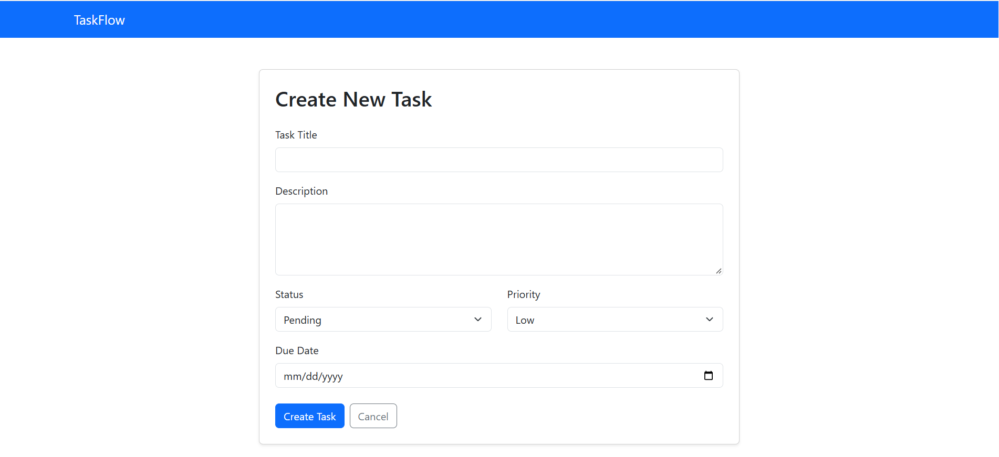
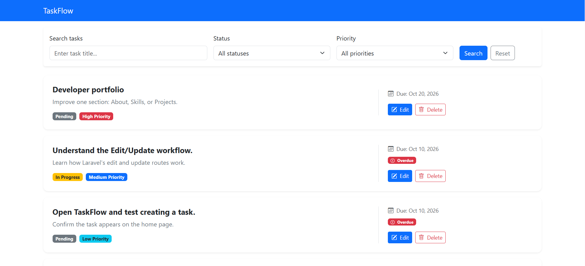
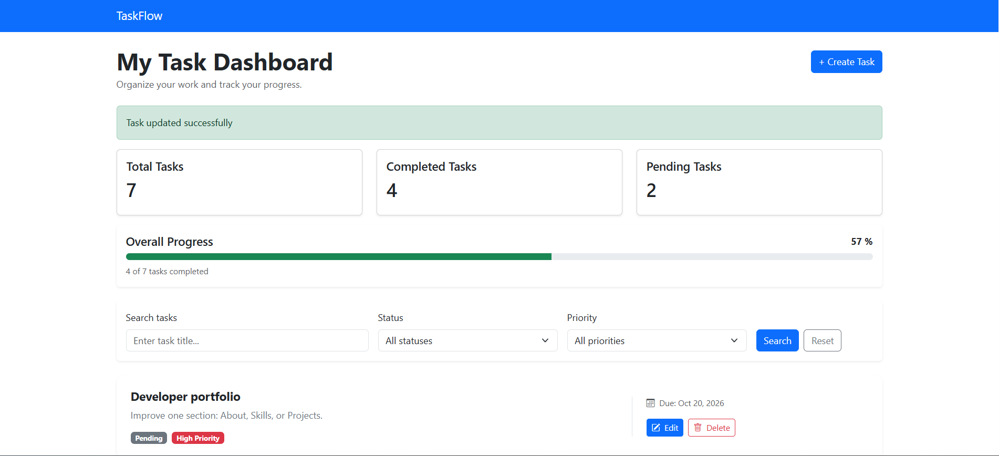
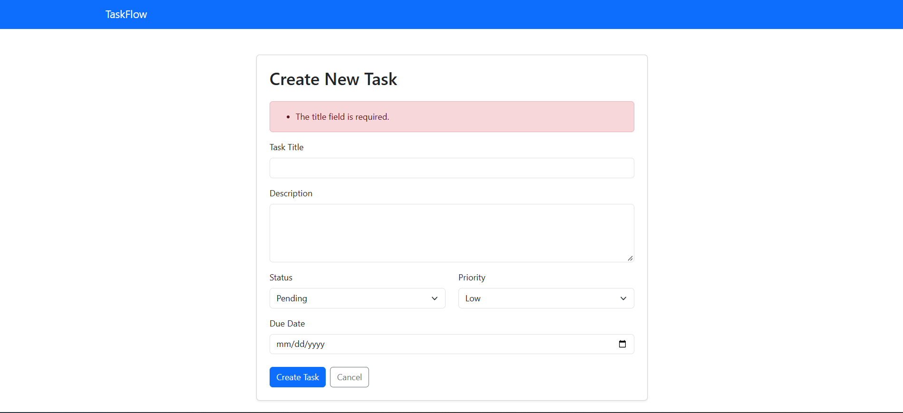

# TaskFlow — Task Management Web Application

TaskFlow is a task management web application built with Laravel to practice and demonstrate web development skills. The project focuses on organizing tasks, managing task information, and building a maintainable application using Laravel and MySQL.

> **Project status:** In Development

## Features

- **Task Creation:** Create new tasks through a web-based form.
- **Input Validation:** Validate submitted task information using Laravel's request validation.
- **Blade Templates:** Render the task creation interface using Laravel Blade.
- **Form Handling:** Process form submissions through Laravel routes and controllers.
- **Error Feedback:** Display validation feedback when submitted task information is invalid.
- **Database Integration:** Built with Laravel and configured to use MySQL for data persistence.


## Screenshots

Screenshots of the TaskFlow application will be added here as development progresses.

### Task Creation Form



### Task List



### Success Message for Updating



### Validation Feedback



## Tech Stack

- **Backend:** PHP, Laravel
- **Frontend:** HTML, CSS, Blade Templates
- **Database:** MySQL
- **Development Environment:** WAMP, Composer, Git, Visual Studio Code

## Getting Started

### Prerequisites

Make sure you have installed:

- PHP (compatible with the Laravel version used by this project)
- Composer
- MySQL
- Node.js and npm, if required by the frontend build setup
- Git

### Installation

**1. Clone the repository**

```bash
git clone https://github.com/ShweYee894/taskflow.git
cd taskflow
```

**2. Install PHP dependencies**

```bash
composer install
```

**3. Configure environment variables**

```bash
copy .env.example .env
```

On Windows, run this command in Command Prompt or PowerShell from the project directory.

**4. Generate the application key**

```bash
php artisan key:generate
```

**5. Configure the database**

Create a MySQL database named `taskflow` or choose another database name.

Update the database settings in your local `.env` file:

```dotenv
DB_CONNECTION=mysql
DB_HOST=127.0.0.1
DB_PORT=3306
DB_DATABASE=taskflow
DB_USERNAME=your_local_username
DB_PASSWORD=your_local_password
```

Use your own local database credentials. Never commit your actual `.env` file.

**6. Run database migrations**

```bash
php artisan migrate
```

**7. Start the development server**

```bash
php artisan serve
```

Open the local URL displayed in your terminal, usually `http://127.0.0.1:8000`.

## Project Structure

```text
taskflow/
├── app/             # Application logic and models
├── database/        # Migrations and seeders
├── resources/
│   └── views/       # Blade templates
├── routes/          # Application routes
├── public/          # Public assets and entry point
├── tests/           # Automated tests
├── .env.example     # Example environment configuration
├── artisan          # Laravel command-line interface
├── composer.json    # PHP dependencies and scripts
└── README.md        # Project documentation
```

## Learning Objectives

- Practice Laravel routing and controllers.
- Build forms and validate user input.
- Work with database migrations and Eloquent models.
- Understand Blade templates and server-rendered pages.
- Follow secure configuration and Git version-control practices.
- Develop a portfolio project through incremental improvements.

## Future Improvements

- Add user authentication and authorization, if not already implemented.
- Add task status, priority, and due-date management.
- Implement search, filtering, and pagination.
- Improve responsive UI and accessibility.
- Add automated tests.
- Explore a React.js frontend in a future development phase.

## Author

Shwe Yee Win

Aspiring PHP / Laravel Web Developer

- GitHub:https://github.com/ShweYee894

## License

This project is intended for learning and portfolio demonstration. A license can be added once the project's distribution terms have been decided.
